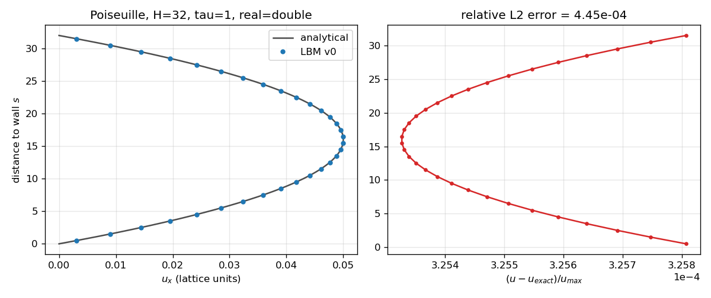

# LBM D2Q9 fluid solver — from CPU to multi-GPU

A 2D Lattice Boltzmann (D2Q9, BGK collision) fluid solver, written in C++17 and CUDA,
developed in successive versions that are all kept, validated against each other and
benchmarked on the same metric (MLUPS, million lattice updates per second).

> **Status: work in progress.** No performance numbers are published yet. Every number
> that will appear here comes from a `results/*.csv` file produced by the benchmark script,
> with the exact hardware, driver, compiler flags, grid size and step count.

## Versions

| Version | Description | Status |
|---|---|---|
| v0 | Sequential CPU — correctness reference | done, validated (Poiseuille) |
| v1 | CPU OpenMP — honest performance baseline: pull scheme, SoA layout, vectorised | done, bitwise identical to v0 |
| v2 | Naive CUDA — one thread per cell | planned |
| v3 | Optimized CUDA — SoA layout, fused collide + stream, double buffering | planned |
| v4 | Multi-GPU MPI + CUDA — domain decomposition, halo exchange, overlap | planned |

## Validation



Plane Poiseuille flow (periodic in x, halfway bounce-back walls, Guo body force), run by
`ctest` in both precisions (`tests/test_poiseuille.cpp`):

| Check | double | float |
|---|---|---|
| A. `tau = 1/2 + sqrt(3)/4` (BGK + bounce-back is exact for this tau) | L2 < 1e-8 | L2 < 2e-4 |
| B. `tau = 1`, H = 16, 32, 64 | L2 < 2e-3, observed order in [1.9, 2.1] | L2 < 2e-3 |
| C. Mass conservation (relative drift) | < 1e-13 | < 1e-6 |

Populations are stored shifted by their rest value (`f_i - w_i`). In single precision this
keeps the float resolution on the flow-dependent part of `f`; without it, the float run
stagnates far from the steady state. Even with it, the float stagnation error (~1e-4) is as
large as the H = 64 discretisation error, so the convergence order is only checked in double.

Cross-version check: v1 and v1_naive (OpenMP) reproduce v0 **bit for bit** for 1, 2, 3, 4 and 8 threads
(`tests/test_v1_vs_v0.cpp`, non-uniform case with an obstacle). Later versions must reproduce
v0 within a justified tolerance.

## Build

```bash
cmake -S . -B build                      # CPU only, real = float
cmake --build build -j
ctest --test-dir build --output-on-failure
```

| CMake option | Default | Effect |
|---|---|---|
| `LBM_ENABLE_CUDA` | `OFF` | Build the CUDA versions (default arch: `sm_75`, Tesla T4) |
| `LBM_ENABLE_MPI` | `OFF` | Build the MPI + CUDA version (requires CUDA) |
| `LBM_REAL_DOUBLE` | `OFF` | Use `double` instead of `float` |
| `LBM_NATIVE` | `OFF` | `-march=native -ffp-contract=off` (vectorisation for the build CPU, no FMA) |

### Run and plot

```bash
./build/src/v0_cpu/lbm_v0 --nx 64 --ny 34 --tau 1.0 --steps 20000 --out output/poiseuille
python3 scripts/plot_poiseuille.py output/poiseuille   # -> docs/poiseuille_profile.png
python3 scripts/plot_fields.py output/poiseuille       # -> output/poiseuille/fields.png
```

Fields are written as NumPy `.npy` files (`rho`, `ux`, `uy`, `vorticity`, `solid`) plus `meta.json`.

### Benchmark

```bash
bench/measure_bandwidth.sh                                    # STREAM -> results/bandwidth_<cpu>.csv
python3 bench/ceiling.py results/bandwidth_<cpu>.csv          # MLUPS ceiling from bandwidth
python3 bench/run_bench.py --exe build/src/v0_cpu/lbm_v0
python3 bench/run_bench.py --exe build/src/v1_omp/lbm_v1 --threads 1 2 4 8
```

Each run does an untimed warm-up, then several timed repetitions inside the process; the CSV
records the CPU, frequency governor, compiler, flags, precision, thread count and git commit.
MLUPS = nx * ny * steps / time / 1e6. The memory-bound ceiling is
bandwidth / (2 * 9 * sizeof(real)) bytes per cell update.

### Docker

```bash
docker build -t lbm-d2q9 -f docker/Dockerfile .
docker run --rm -it --gpus all -v "$PWD":/workspace lbm-d2q9
```

## Toolchain

- C++17, CMake ≥ 3.20, OpenMP, Open MPI.
- CUDA toolkit: **12.4** (Docker image `nvidia/cuda:12.4.1-devel-ubuntu22.04`), chosen to be
  no newer than the toolkit and driver available on Google Colab. To be confirmed against
  `nvcc --version` and `nvidia-smi` on Colab before the first GPU measurements.
