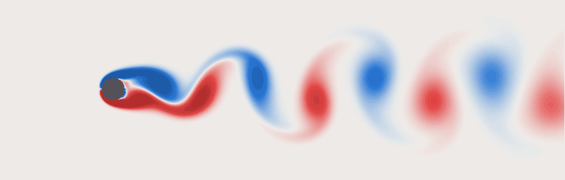
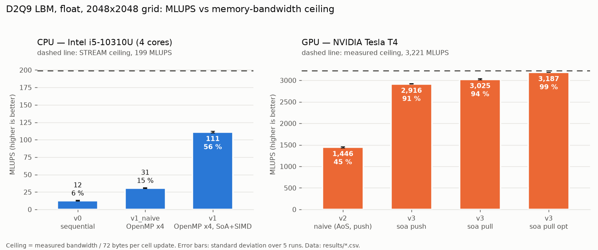

# LBM D2Q9 fluid solver — from CPU to multi-GPU

[](https://github.com/H-HABCHANE/Simulation-de-fluide-par-la-m-thode-de-Boltzmann-sur-r-seau-LBM-du-CPU-au-multi-GPU/actions/workflows/ci.yml)


A 2D Lattice Boltzmann (D2Q9, BGK collision) fluid solver, written in C++17 and CUDA,
developed in successive versions that are all kept, validated against each other and
benchmarked on the same metric (MLUPS, million lattice updates per second).



*Vorticity behind a cylinder at Re = 100 (blue: clockwise, red: counter-clockwise),
computed with this solver; 4 shedding periods.*

> **Status: work in progress** (multi-GPU scaling measurements and final write-up to come).
> Every number below comes from a `results/*.csv` file produced by the benchmark scripts,
> which also record the hardware, driver, compiler, flags, grid size, step count and commit.

## Versions

| Version | Description | Status |
|---|---|---|
| v0 | Sequential CPU — correctness reference | done, validated (Poiseuille) |
| v1 | CPU OpenMP — honest performance baseline: pull scheme, SoA layout, vectorised | done, bitwise identical to v0 |
| v2 | Naive CUDA — one thread per cell, same layout as v0 | done, bitwise identical to v0 on a Tesla T4 |
| v3 | Optimized CUDA — SoA layout, pull streaming, no modulo; variants kept for measurement | done, bitwise identical to v0 on a Tesla T4 |
| v4 | Multi-GPU MPI + CUDA — strips of rows, halo exchange, overlap | done, bitwise identical to v0 with 1 to 4 ranks; scaling not yet measured (single GPU) |

## Validation


Plane Poiseuille flow (periodic in x, halfway bounce-back walls, Guo body force), run by
`ctest` in both precisions (`tests/test_poiseuille.cpp`):

| Check | double | float |
|---|---|---|
| A. `tau = 1/2 + sqrt(3)/4` (BGK + bounce-back is exact for this tau) | L2 < 1e-8 | L2 < 2e-4 |
| B. `tau = 1`, H = 16, 32, 64 | L2 < 2e-3, observed order in [1.9, 2.1] | L2 < 2e-3 |
| C. Mass conservation (relative drift) | < 1e-13 | < 1e-6 |

Populations are stored shifted by their rest value (`f_i - w_i`). In single precision this
keeps the float resolution on the flow-dependent part of `f`; without it, the float run
stagnates far from the steady state. Even with it, the float stagnation error (~1e-4) is as
large as the H = 64 discretisation error, so the convergence order is only checked in double.

Cross-version checks (non-uniform case with an obstacle, 500 steps):
- v1 and v1_naive (OpenMP) reproduce v0 **bit for bit** for 1, 2, 3, 4 and 8 threads
  (`tests/test_v1_vs_v0.cpp`);
- v2 (CUDA, `--fmad=false`) reproduces v0 **bit for bit** on a Tesla T4, in float and double
  (`tests/test_v2_vs_v0.cu`), and passes the Poiseuille test on the GPU;
- `compute-sanitizer` (memcheck, initcheck, racecheck, synccheck): 0 errors on v2.
- v3: every variant (`LBM_V3_VARIANT=soa_push|soa_pull|soa_pull_opt`) is tested bit for bit
  against v0 and with the Poiseuille test on the GPU (`tests/test_v3_vs_v0.cu`).

## Flow past a cylinder (Re = 100)

1000 x 320 grid, cylinder diameter D = 40 cells, inlet velocity 0.05 (Mach 0.087),
tau = 0.56, 160 000 steps. Inlet: equilibrium at the inlet velocity; outlet: zero gradient;
periodic in y (blockage D/H = 12.5 %). The cylinder is placed one cell above mid-height, which
triggers the vortex shedding deterministically.

| Quantity | Value | Source |
|---|---|---|
| Strouhal number St = f D / U (FFT of the probe signal) | 0.1807 | `results/strouhal.csv` |
| Same, from the mean period between zero crossings | 0.1805 | `results/strouhal.csv` |
| Periods analysed (established regime, steps 88 000 to 160 000) | 15 | `results/strouhal.csv` |
| Same run with v3 on a Tesla T4 | St 0.1807 / 0.1805, identical amplitude | `results/strouhal.csv` |
| Same run with v4, 2 MPI ranks on the Tesla T4 | St 0.1807 / 0.1805, identical amplitude | `results/strouhal.csv` |

The reference value for an unconfined cylinder at Re = 100 is St = 0.164 (Williamson, 1996);
the 12.5 % blockage of this periodic domain speeds up the flow around the cylinder and raises
St, so this is a plausibility check rather than a fine validation. The run is deterministic:
re-running it from the recorded commit reproduces the probe signal bit for bit.

```bash
./build/src/v1_omp/lbm_v1 --case cylinder --nx 1000 --ny 320 --diameter 40 --re 100 --umax 0.05 \
    --steps 160000 --frame-every 450 --frame-start 142000 --out output/cylinder
python3 scripts/strouhal.py output/cylinder --from 0.55   # -> results/strouhal.csv
python3 scripts/make_video.py output/cylinder             # -> docs/karman.gif
```

Open boundaries are implemented in v0, v1 and v3 with copies only, so v1 and v3 remain bitwise
identical to v0 on this case too (`tests/test_cylinder_v1.cpp`, `tests/test_cylinder_v3.cu`, the
latter run on the Tesla T4 with `compute-sanitizer` clean): the CPU run (v1) and the GPU run
(v3) give the same probe statistics to the last printed digit.

## Multi-GPU version (v4)

One MPI rank per GPU; the domain is split into strips of rows (rows are contiguous in memory,
so a halo row is one contiguous block per population, and the inlet/outlet columns stay
local to every rank). Each rank stores its rows plus one ghost row above and below. After
each step only the 3 populations that cross a strip boundary are exchanged: those going up
(`i = 2, 5, 6`) to the rank above, those going down (`i = 4, 7, 8`) to the rank below, i.e.
3 x nx values per message. Halos go through page-locked host buffers. Overlap: the two
boundary rows are computed first, then the interior rows run in a second CUDA stream while the
halos are copied and exchanged (`LBM_V4_OVERLAP=0` disables it).

- The same cell update (`src/v4_mpi_cuda/strip_update.hpp`) is compiled for a GPU engine and
  for a CPU engine; the CPU engine runs the MPI logic without a GPU, in CI.
- v4 is bitwise identical to v0 with 1, 2, 3 and 4 ranks (3 gives strips of unequal height),
  with and without overlap, on the periodic obstacle case and on the cylinder
  (`tests/test_v4_vs_v0.cpp`, run by CI with the CPU engine and on a Tesla T4 with the GPU
  engine, ranks sharing the GPU); `compute-sanitizer` (memcheck, initcheck, synccheck) is clean
  with 2 ranks, and the cylinder run with 2 ranks gives the same Strouhal number as v1 and v3.
- **No scaling result is published yet**: it requires one GPU per rank.
  `bench/run_scaling.py` (strong and weak scaling) records the number of distinct GPUs and
  marks runs where ranks share a device as invalid; `scripts/plot_scaling.py` refuses to plot
  them.

```bash
cmake -S . -B build -DLBM_ENABLE_CUDA=ON -DLBM_ENABLE_MPI=ON && cmake --build build -j
mpirun -np 4 build/src/v4_mpi_cuda/lbm_v4 --case cylinder --nx 1000 --ny 320 --diameter 40 --steps 160000
python3 bench/run_scaling.py --exe build/src/v4_mpi_cuda/lbm_v4 --mode strong --np 1 2 4 8
```

## Performance



Float, 2048 x 2048 grid. The ceiling of each machine is its measured memory bandwidth divided
by the 72 bytes moved per cell update (9 populations read, 9 written).

| Version | Machine | MLUPS | % of ceiling | Source |
|---|---|---|---|---|
| v0 sequential | Intel i5-10310U, 1 core | 12.4 | 6 % | `results/v0_i5-10310U.csv` |
| v1_naive OpenMP | i5-10310U, 4 threads | 30.5 | 15 % | `results/v1_naive_i5-10310U.csv` |
| v1 OpenMP, pull + SoA + SIMD | i5-10310U, 4 threads | 110.8 | 56 % (of 199) | `results/v1_i5-10310U.csv` |
| v2 naive CUDA (AoS, push) | Tesla T4 | 1,446 | 45 % | `results/v3_steps_Tesla-T4.csv` |
| v3 CUDA, SoA + pull, no modulo | Tesla T4 | 3,187 | 99 % (of 3,221) | `results/v3_steps_Tesla-T4.csv` |

- CPU ceiling: STREAM Copy, 14.3 GB/s. GPU ceiling: best of a copy kernel and
  `cudaMemcpy` device-to-device, 231.9 GB/s (ECC on); the T4 datasheet gives 320 GB/s.
- v2 and v3 were measured in the same session; GPU results vary by about 5 % between
  sessions on the shared cloud machine.
- GPU vs CPU speedups compare two different machines: v3 is 29x faster than v1 on this pair,
  mostly because the T4 has 16x the memory bandwidth of the laptop.

What changed from v2 to v3, measured with Nsight Compute on one time step
(`results/ncu_Tesla-T4.csv`, sectors per request: 4 = fully coalesced warp access):

| Kernel | DRAM bytes per cell | Load sectors / request | Store sectors / request |
|---|---|---|---|
| v2 (AoS, push) | 141.8 | 21.1 | 32.0 |
| v3 soa_push | 101.3 | 2.7 | 4.7 |
| v3 soa_pull | 96.2 | 3.1 | 4.0 |
| v3 soa_pull_opt | 94.1 | 3.1 | 4.0 |

The structure-of-arrays layout makes the accesses coalesced (v2 stores touch 32 sectors per
warp request: every 4-byte write lands in a different sector); pull streaming makes the stores
perfectly aligned; removing the integer modulo cuts the remaining instruction overhead.
The DRAM traffic stays above the ideal 72 bytes per cell (reasons still to be identified:
ECC, which is enabled on this GPU, and the reuse of neighbouring rows in the L2 cache are
candidates), while the useful bandwidth of v3 (3,187 MLUPS x 72 bytes = 229 GB/s) matches the
`cudaMemcpy` reference.

## Build

```bash
cmake -S . -B build                      # CPU only, real = float
cmake --build build -j
ctest --test-dir build --output-on-failure
```

| CMake option | Default | Effect |
|---|---|---|
| `LBM_ENABLE_CUDA` | `OFF` | Build the CUDA versions (default arch: `sm_75`, Tesla T4) |
| `LBM_ENABLE_MPI` | `OFF` | Build v4 (MPI): GPU engine with CUDA, CPU engine without |
| `LBM_MPIEXEC_FLAGS` | empty | Extra `mpiexec` flags for the MPI tests, e.g. `--oversubscribe` |
| `LBM_REAL_DOUBLE` | `OFF` | Use `double` instead of `float` |
| `LBM_NATIVE` | `OFF` | `-march=native -ffp-contract=off` (vectorisation for the build CPU, no FMA) |
| `LBM_CUDA_FMAD` | `OFF` | Allow FMA contraction in CUDA kernels (speed measurement only; breaks bitwise equality with v0) |

Run-time selection for the CUDA versions: `LBM_BLOCK=32x8` (block size) and, for v3,
`LBM_V3_VARIANT=soa_push|soa_pull|soa_pull_opt` (default `soa_pull_opt`).

### Run and plot

```bash
./build/src/v0_cpu/lbm_v0 --nx 64 --ny 34 --tau 1.0 --steps 20000 --out output/poiseuille
python3 scripts/plot_poiseuille.py output/poiseuille   # -> docs/poiseuille_profile.png
python3 scripts/plot_fields.py output/poiseuille       # -> output/poiseuille/fields.png
```

Fields are written as NumPy `.npy` files (`rho`, `ux`, `uy`, `vorticity`, `solid`) plus `meta.json`.

### Benchmark

```bash
bench/measure_bandwidth.sh                                    # STREAM -> results/bandwidth_<cpu>.csv
python3 bench/ceiling.py results/bandwidth_<cpu>.csv          # MLUPS ceiling from bandwidth
python3 bench/run_bench.py --exe build/src/v0_cpu/lbm_v0
python3 bench/run_bench.py --exe build/src/v1_omp/lbm_v1 --threads 1 2 4 8
```

Each run does an untimed warm-up, then several timed repetitions inside the process; the CSV
records the CPU, frequency governor, compiler, flags, precision, thread count and git commit.
MLUPS = nx * ny * steps / time / 1e6. The memory-bound ceiling is
bandwidth / (2 * 9 * sizeof(real)) bytes per cell update.

### GPU on Google Colab

[`notebooks/run_colab.ipynb`](notebooks/run_colab.ipynb) builds the CUDA versions for a Tesla T4
(`sm_75`), runs all tests and `compute-sanitizer`, measures the GPU bandwidth
(`bench/gpu_bandwidth.cu`) and benchmarks the solver. Open it in Colab with a T4 runtime and
run all cells; the CSV files land in `results/`.

### Docker

```bash
docker build -t lbm-d2q9 -f docker/Dockerfile .
docker run --rm -it --gpus all -v "$PWD":/workspace lbm-d2q9
```

## Toolchain

- C++17, CMake ≥ 3.20, OpenMP, Open MPI.
- CUDA toolkit: **13.0**, as on Google Colab (Tesla T4: nvcc 13.0.88, driver 580.82.07,
  ECC on). Docker image and CUDA CI job: `nvidia/cuda:13.0.2-devel-ubuntu24.04`.
